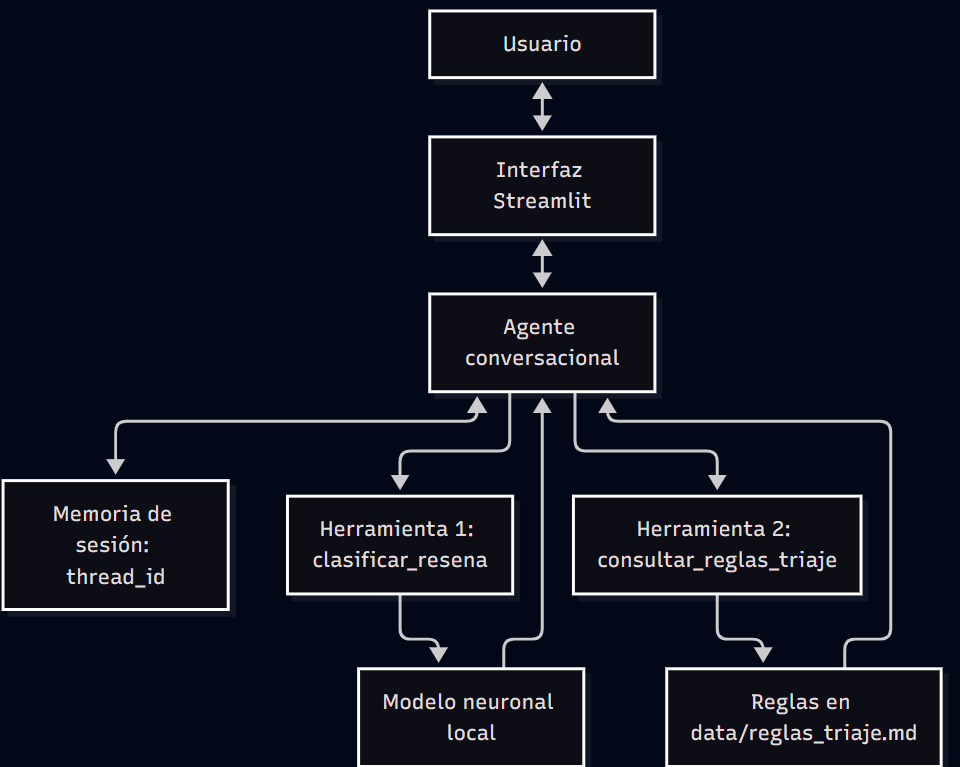
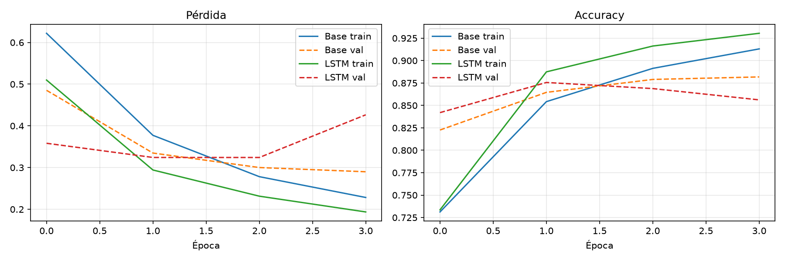
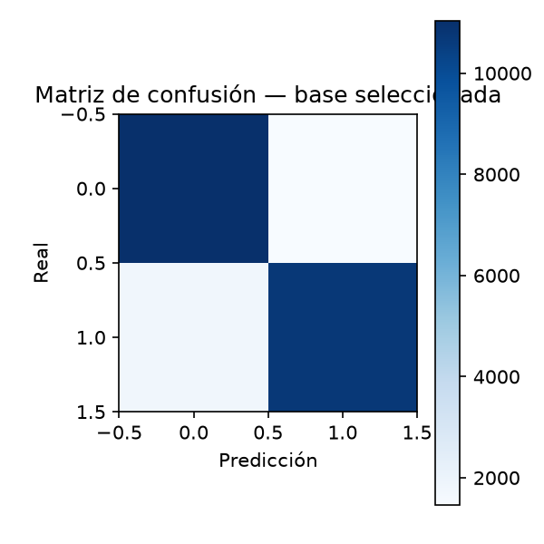

# Analizador de reseñas y triaje

Prototipo interactivo que clasifica reseñas de películas como positivas o negativas mediante una red neuronal entrenada con IMDb. Incluye un agente conversacional que puede usar el clasificador y consultar reglas locales de triaje.

## 1. Identificación, ruta y propuesta de valor

- **Integrantes:** Andrés Felipe Sánchez y Kevin Orlando García.
- **Ruta:** Ruta 3 — PLN con Embeddings + Agente de Triaje Inteligente.
- **Dataset:** IMDb Reviews, cargado mediante `tensorflow.keras.datasets.imdb`.
- **Interfaz:** Streamlit.

El sistema estima si una reseña de película expresa sentimiento positivo o negativo y muestra una probabilidad asociada. El agente permite pedir una clasificación, consultar las reglas locales de triaje o combinar ambas acciones. Recomienda revisión humana para reseñas negativas o predicciones con confianza menor al 65 %. Esa recomendación es una regla didáctica del prototipo, no una política oficial de IMDb. La red neuronal clasifica el texto con patrones aprendidos durante el entrenamiento. El agente coordina herramientas y permite consultar sus resultados en lenguaje natural; no vuelve a entrenar ni reemplaza el modelo.

| Componente | Función | Evidencia |
|---|---|---|
| Clasificador U4 | Predice el sentimiento y entrega probabilidad | `notebooks/entrenamiento_u4.ipynb`, `src/model.py` |
| Agente U5 | Decide si consulta clasificador, reglas o ninguna herramienta | `src/agent.py`, `notebooks/evaluacion_agente_u5.ipynb` |
| Interfaz | Permite ingresar reseñas, conversar y ver herramientas invocadas | `app.py` |

La red neuronal resuelve la clasificación del texto; el agente permite consultarla en lenguaje natural y complementa el resultado con reglas del proyecto. Así, la interfaz ofrece tanto una predicción directa como una conversación para entender el resultado y el criterio de triaje.

## 2. Arquitectura del sistema

1. El usuario ingresa una reseña o pregunta en Streamlit.
2. El agente determina si necesita una herramienta.
3. `clasificar_resena` ejecuta el modelo neuronal local.
4. `consultar_reglas_triaje` busca en `data/reglas_triaje.md`.
5. El agente formula una respuesta y la interfaz muestra el resultado.
6. Los mensajes se asocian a un `thread_id`; la interfaz permite reiniciar la sesión.


### Diagrama de arquitectura



La memoria conserva el contexto durante la sesión activa de la aplicación. Reiniciar la conversación crea un contexto nuevo; no se trata de almacenamiento permanente entre reinicios del servidor.

## 3. Ingeniería del modelo y análisis de un fallo real

El notebook `notebooks/entrenamiento_u4.ipynb` compara dos arquitecturas. El preprocesamiento limita el vocabulario a 12 000 palabras y las secuencias a 250 tokens; convierte el texto a minúsculas y elimina puntuación.

**Modelo base:** Embedding de 32 dimensiones, Global Average Pooling, Dense de 32 unidades con ReLU, Dropout de 0.3 y salida sigmoide.

**Modelo candidato:** Embedding de 48 dimensiones, LSTM de 32 unidades con Dropout de 0.25, Dense de 24 unidades con ReLU, Dropout de 0.35 y salida sigmoide.

Ambos se entrenaron con Adam, entropía cruzada binaria, exactitud, cuatro épocas y lotes de 128 ejemplos.

| Modelo | Exactitud validación | Exactitud prueba | Pérdida prueba |
|---|---:|---:|---:|
| Base: Embedding + Global Average Pooling + Dense | 88.18 % | 87.11 % | 0.3057 |
| Candidato: Embedding + LSTM + Dense | 85.62 % | 83.44 % | 0.4834 |

Se seleccionó el modelo base por su mejor exactitud de validación y prueba, y menor pérdida de prueba. En este experimento, añadir una LSTM no mejoró el resultado.





En el análisis del notebook, la muestra de prueba con índice 8 tenía etiqueta real negativa (0), pero fue predicha como positiva (1), con probabilidad aproximada de 0.9638 para la clase positiva. El error muestra que una probabilidad alta no garantiza una predicción correcta. Ironía, negaciones, ambigüedad y expresiones poco representadas pueden confundir al modelo; la probabilidad es una estimación, no una certeza.

## 4. Diseño del agente y matriz de evaluación

- **`clasificar_resena`:** recibe una reseña, aplica el preprocesamiento y ejecuta el modelo local. Devuelve la clase positiva o negativa y una probabilidad.
- **`consultar_reglas_triaje`:** busca párrafos relacionados en `data/reglas_triaje.md` mediante coincidencias de palabras. Es una búsqueda textual sencilla, no una búsqueda vectorial con embeddings.
- **Selección:** los saludos y preguntas generales pueden responderse sin herramientas; una clasificación requiere la primera herramienta; una consulta sobre reglas requiere la segunda; una petición combinada puede usar ambas.
- **Memoria:** `thread_id` asocia turnos a una sesión activa. La interfaz permite reiniciarla.
- **Cuota:** la clasificación y las reglas son locales. Google AI Studio se usa para la conversación del agente; sus llamadas pueden consumir cuota.

La ejecución registrada de `notebooks/evaluacion_agente_u5.ipynb` pasó los cuatro casos de evaluación:

| Caso | Herramienta esperada | Herramienta invocada | Resultado |
|---|---|---|---|
| Saludo o pregunta general | Ninguna | Ninguna | Correcto |
| Consulta de reglas | `consultar_reglas_triaje` | `consultar_reglas_triaje` | Correcto |
| Clasificación | `clasificar_resena` | `clasificar_resena` | Correcto |
| Clasificación y triaje | Ambas | Ambas | Correcto |

Son cuatro casos representativos; no garantizan selección correcta para toda consulta.

## 5. Bitácora de Vibe Coding y razonamiento crítico

La bitácora de apoyo con IA está en `assets/bitacora_ia.md`. Se usaron asistentes de IA como apoyo de programación y revisión técnica; las sugerencias se deben contrastar con el código y las salidas.

Durante la evaluación con la API apareció un aviso del SDK indicando que el modelo podía utilizar valores predeterminados de muestreo e ignorar `temperature`. Por eso, configurar `temperature=0` no garantiza respuestas generativas idénticas entre ejecuciones. Esta observación limita la reproducibilidad exacta de las respuestas del agente. La clasificación local, en cambio, depende de los pesos entrenados.

## 6. Demostración de la interfaz

La interfaz permite clasificar reseñas, conversar con el agente, ver qué herramientas fueron invocadas y reiniciar una sesión.

- [Curvas de entrenamiento y validación](assets/curvas_entrenamiento.png)
- [Matriz de confusión](assets/matriz_confusion.png)
- [Diagrama de arquitectura](assets/diagrama_arquitectura.png)

No se encontró una captura de la aplicación entre los archivos del proyecto. El equipo grabó un video de demostración de 1 minuto y 33 segundos. [Ver el video en Google Drive](https://drive.google.com/file/d/1n15zZOQm7i9kF-hScmlkJ1d6zY6pYqTS/view?usp=sharing).

## 7. Instalación y ejecución reproducible

### Requisitos

Python 3.13, Git y una clave de Google AI Studio para utilizar el agente.

### Windows PowerShell

```powershell
git clone https://github.com/KevinGarcia582/Proyecto-Ia.git
cd Proyecto-Ia

py -3.13 -m venv .venv
.\.venv\Scripts\Activate.ps1
python -m pip install -r requirements.txt
Copy-Item .env.example .env
notepad .env
```

Configurar `GOOGLE_API_KEY` localmente en `.env`. No compartir la clave ni subir el archivo. `.gitignore` excluye `.env`.

### Entrenamiento y ejecución

1. Ejecutar `notebooks/entrenamiento_u4.ipynb de principio a fin para preparar IMDb, entrenar y comparar modelos, guardar gráficas y exportar pesos.
2. Ejecutar `notebooks/evaluacion_agente_u5.ipynb para revisar las herramientas y los casos. Requiere la clave y puede consumir cuota.
3. Iniciar la aplicación:

```powershell
streamlit run app.py
```

### Archivos principales

```text
app.py
src/
  agent.py
  model.py
data/
  imdb_word_index.json
  reglas_triaje.md
notebooks/
  entrenamiento_u4.ipynb
  evaluacion_agente_u5.ipynb
models/
assets/
  curvas_entrenamiento.png
  matriz_confusion.png
  bitacora_ia.md
requirements.txt
.env.example
.gitignore
README.md
```

## Conclusión

El sistema combina una red neuronal para clasificar reseñas con un agente que coordina herramientas y aplica reglas sencillas de triaje. En los resultados registrados, el modelo base superó al candidato con LSTM; la evaluación del agente cubrió cuatro casos. El prototipo permite estudiar clasificación de texto y agentes con herramientas, pero sus predicciones pueden equivocarse, sus reglas son limitadas y su evaluación es pequeña. Sus resultados son orientativos.
